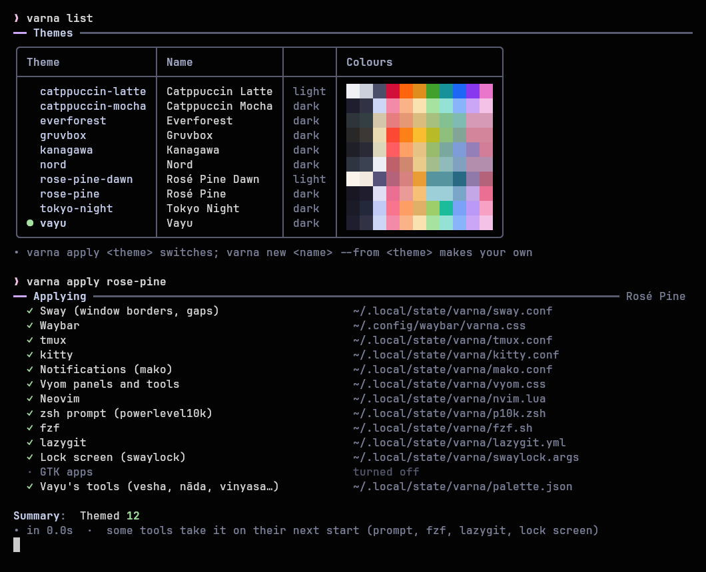
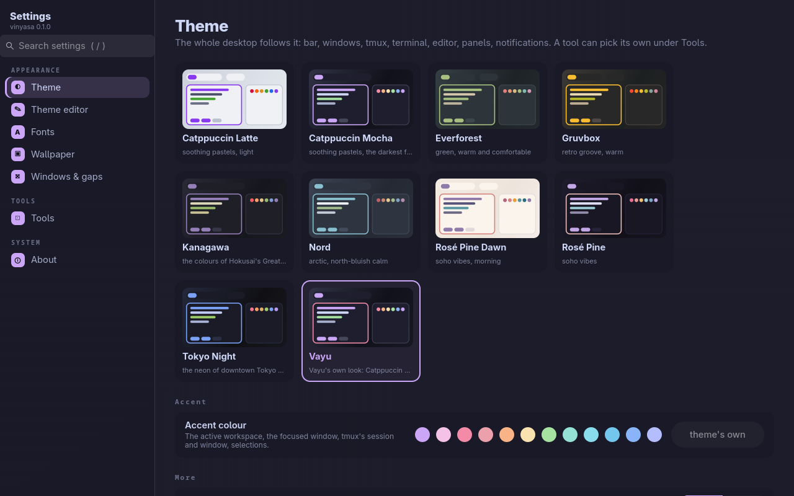

<p align="center">
  <picture>
    <source media="(prefers-color-scheme: dark)" srcset="assets/banner-dark.svg">
    <source media="(prefers-color-scheme: light)" srcset="assets/banner-light.svg">
    
  </picture>
</p>

<p align="center">
  <b>One theme for every tool.</b><br>
  Pick a theme once and sway, waybar, tmux, kitty, Neovim, your notifications, prompt, lock screen and panels all take it, live, with any tool free to keep a theme of its own.
</p>

<p align="center">
  <a href="https://github.com/Theyashsawarkar/varna/actions/workflows/ci.yml"></a>
  <a href="https://github.com/Theyashsawarkar/varna/releases"></a>
  <a href="LICENSE"></a>
  
</p>

> *Varna* (वर्ण) is Sanskrit for "colour".

A Linux desktop is a dozen programs, each with its own colour settings in
its own format: hex codes in sway's config, CSS in waybar, `#{}` formats in
tmux, a colour table in kitty, Lua in Neovim. Changing the look means
editing all of them, and they drift apart. **varna** keeps one theme (a
small TOML file of named colours) and writes each tool's colours from it,
into a file the tool's config includes. Switch the theme and every tool
changes within a second, reloaded in place.

<p align="center">
  
</p>

## Contents

- [Features](#features)
- [Install](#install)
- [Getting started](#getting-started)
- [Themes](#themes)
- [Commands](#commands)
- [Hooking up each tool](#hooking-up-each-tool)
- [A tool with its own theme](#a-tool-with-its-own-theme)
- [Making a theme](#making-a-theme)
- [Theming any file](#theming-any-file)
- [For tool authors](#for-tool-authors)
- [Troubleshooting](#troubleshooting)
- [Contributing](#contributing)
- [License](#license)

## Features

- **Thirteen tools from one theme**: sway (borders, gaps, corners), waybar,
  tmux (bar, borders, popups, copy mode), kitty, mako, Vyom panels, Neovim,
  powerlevel10k, fzf, lazygit, swaylock, btop and GTK apps, plus a JSON palette any
  program can read.
- **Live**: every running tool reloads in place (sway, waybar, every tmux
  server, every kitty window, every Neovim through its socket, mako, Vyom).
- **Your configs stay yours**: each tool includes one generated file;
  nothing else in its config is touched, and without varna it keeps working
  on its own values.
- **Per-tool themes**: `varna tool nvim tokyo-night` gives one tool its own
  theme while the rest follow the desktop.
- **Ten themes to start**: Vayu, Catppuccin Mocha and Latte, Rosé Pine and
  Dawn, Tokyo Night, Gruvbox, Nord, Kanagawa, Everforest; light/dark twins
  switch with `varna mode toggle`.
- **Your own themes**: `varna new "Rose Dusk" --from nord`, then edit the
  colours (or use [vinyasa](https://github.com/Theyashsawarkar/vinyasa)'s editor).
- **Any file**: `varna template add` themes any config with `{{accent}}`-style
  placeholders.
- **Safe**: a typo in a template is an error, never a silently broken colour;
  a throwaway `HOME` never restyles the running desktop.
- **No dependencies** beyond Python 3.11's standard library.

## Install

With [kosha](https://github.com/Theyashsawarkar/kosha): `kosha install varna`.

Or the installer (clones into `~/.local/share/varna`, links `~/.local/bin/varna`, no root):

```sh
curl -fsSL https://raw.githubusercontent.com/Theyashsawarkar/varna/main/install.sh | bash
```

Or by hand: `git clone https://github.com/Theyashsawarkar/varna ~/.local/share/varna && ln -s ~/.local/share/varna/bin/varna ~/.local/bin/varna`.

## Getting started

```sh
varna doctor            # what each tool's config needs to include (one line each)
varna apply             # write and reload every tool with the current theme (Vayu)
varna apply rose-pine   # switch
varna set accent blue   # keep the theme, change the accent
varna mode toggle       # its light / dark twin
```

[vinyasa](https://github.com/Theyashsawarkar/vinyasa), Vayu's settings app, is a
window over all of this: theme cards, accent swatches, a theme editor, and a
per-tool page.

<p align="center">
  
</p>

## Themes

| Theme | Variant | Accent |
| --- | --- | --- |
| `vayu` | dark | mauve, with rose borders: Vayu's own look |
| `catppuccin-mocha` / `catppuccin-latte` | dark / light | mauve |
| `rose-pine` / `rose-pine-dawn` | dark / light | iris |
| `tokyo-night` | dark | blue |
| `gruvbox` | dark | yellow |
| `nord` | dark | frost |
| `kanagawa` | dark | violet |
| `everforest` | dark | green |

`varna show <theme>` prints its palette and roles as swatches.

## Commands

| Command | Does |
| --- | --- |
| `varna` / `varna status` | The desktop's theme, accent and each tool's pick |
| `varna list` | Every theme with its colours (`--json`) |
| `varna apply [theme]` | Switch (or re-apply) and reload every tool (`--only tmux,kitty`, `--no-reload`) |
| `varna mode dark\|light\|toggle` | The theme's light or dark twin |
| `varna set <setting> <value>` | `accent`, `gtk on\|off`, `ui.opacity`, `ui.gaps`, `ui.radius`, `ui.border_width`, `ui.font`, `ui.mono`, `ui.size`, `ui.mono_size` |
| `varna show [theme] [--tool t]` | Palette and roles as swatches |
| `varna tool <tool> [theme\|follow]` | One tool's own theme |
| `varna tools` | Every tool, its theme, and whether its config includes varna |
| `varna new <name> [--from theme]` | A theme of your own |
| `varna edit <theme>` | Open it in `$EDITOR` (a shipped theme is copied first) |
| `varna delete <theme>` | Delete a theme of yours |
| `varna template add\|remove\|list` | Theme any file |
| `varna palette [--tool t]` | The resolved colours as JSON |
| `varna ensure` | Write any missing file without reloading (run at login) |
| `varna doctor` | Check every theme and every tool's hook |

Shorthand: `varna nord` = `varna apply nord`.

## Hooking up each tool

Each tool's config includes varna's file once. `varna doctor` checks every
one and prints the line that's missing; put your current colours in the
config before the include, and they become the fallback.

| Tool | Add to | Line |
| --- | --- | --- |
| sway | `~/.config/sway/config`, at the end | `include ~/.local/state/varna/sway*.conf` |
| waybar | `~/.config/waybar/style.css`, at the top | `@import "varna.css";` then use `@accent`, `@base`, `alpha(@red, 0.4)`... |
| tmux | `~/.config/tmux/tmux.conf`, at the end | `source-file -q ~/.local/state/varna/tmux.conf` (formats can use `#{@accent}`, `#{@ink}`...) |
| kitty | `~/.config/kitty/kitty.conf`, at the end | `include ~/.local/state/varna/kitty.conf` |
| mako | `~/.config/mako/config`, before the first `[section]` | `include=~/.local/state/varna/mako.conf` |
| Vyom | `~/.config/vyom/config.toml`, `[vyom]` | `css = ["~/.local/state/varna/vyom.css"]` |
| Neovim | `lua/varna.lua` | reads `~/.local/state/varna/nvim.lua` into catppuccin's `color_overrides` ([example](https://github.com/Theyashsawarkar/vayu/blob/main/nvim/.config/nvim/lua/varna.lua)) |
| powerlevel10k | `~/.zshrc`, after `~/.p10k.zsh` | `source ~/.local/state/varna/p10k.zsh` |
| fzf | `~/.zshrc` | `source ~/.local/state/varna/fzf.sh` (sets `FZF_DEFAULT_OPTS`, `$VARNA_FZF_COLORS` and `$VARNA_RGB_ACCENT`, `$VARNA_RGB_FG`... for scripts' own colours) |
| lazygit | `~/.zshrc` | `export LG_CONFIG_FILE="$HOME/.config/lazygit/config.yml,$HOME/.local/state/varna/lazygit.yml"` |
| swaylock | your lock command | `swaylock $(cat ~/.local/state/varna/swaylock.args)` |
| btop | your btop command | `btop -c ~/.local/state/varna/btop.conf` (varna sets its theme there; btop keeps its other settings in it) |
| GTK apps | nothing: `varna set gtk on` | links `~/.config/gtk-{3,4}.0/gtk.css` (libadwaita's named colours) |

waybar and mako refuse to start when an included file is missing: run
`varna ensure` before them at login.

## A tool with its own theme

```sh
varna tool nvim tokyo-night    # Neovim alone uses Tokyo Night
varna tool nvim follow         # back to the desktop's theme
varna tools                    # who uses what
```

`~/.config/varna/varna.toml` (written by varna and vinyasa; edit freely):

```toml
theme = "rose-pine"
accent = "iris"            # optional: a palette name or a hex
gtk = true

[ui]
gaps = 8
opacity = 0.9

[tools]
nvim = "tokyo-night"
kitty = { opacity = 0.95 }  # or just tweak one value for one tool
```

## Making a theme

```sh
varna new "Rose Dusk" --from vayu     # ~/.config/varna/themes/rose-dusk.toml
varna edit rose-dusk
varna apply rose-dusk
```

```toml
[meta]
name = "Rose Dusk"
variant = "dark"          # "light" for a light theme
light = "rose-dawn"       # optional: its twin, for `varna mode`

[palette]                 # these 26 names (Catppuccin's), all #rrggbb
crust = "#11111b"  mantle = "#181825"  base = "#1e1e2e"  # ... text, red, green, blue, mauve ...

[roles]                   # optional: a palette name, another role, or a hex
accent = "mauve"          # the active workspace, tmux session, selections
accent2 = "pink"          # popup and pane borders
border = "accent"         # the focused window
urgent = "red"
ink = "crust"             # text on a coloured capsule

[ui]                      # optional
radius = 12
gaps = 4

[tools.tmux]              # optional: extra colours one tool's template asks for
window_idle = "#9a9faa"
```

Roles not set take their defaults (`varna show` lists them all).

## Theming any file

Any file can be a template: `{{accent}}` and friends are replaced on every
apply.

```sh
varna template add ~/.config/foo/config.varna ~/.config/foo/config --tool foo
```

| Write | Get |
| --- | --- |
| `{{accent}}` | `#cba6f7` |
| `{{accent:upper}}` / `{{accent:bare}}` | `#CBA6F7` / `cba6f7` |
| `{{base:a=0.35}}` | `#1e1e2e59` (with alpha) |
| `{{red:rgb}}` / `{{red:rgba=0.4}}` | `243, 139, 168` / `rgba(243, 139, 168, 0.4)` |
| `{{red:semi}}` | `243;139;168` (for terminal colour codes) |
| `{{red:alpha=0.4}}` | `alpha(#f38ba8, 0.4)` (GTK CSS) |
| `{{peach:mix=base:0.3}}` | peach blended 30 % toward base |
| `{{window_idle\|overlay1}}` | a fallback when the theme lacks a name |
| `{{gaps}}`, `{{font}}`, `{{theme_name}}` | ui values and the theme's name |
| `?swayfx corner_radius 12` | the line only on SwayFX |

An unknown name is an error, so a typo never ships a broken colour.

## For tool authors

`~/.local/state/varna/palette.json` has the desktop's colours, roles and ui
values, and a `tools` table with each tool's own pick. Read it at start, and
watch its modification time to recolour live:

```python
import json, os
p = os.path.expanduser("~/.local/state/varna/palette.json")
try:
    data = json.load(open(p))
    colors = data.get("tools", {}).get("mytool", data)["colors"]   # my own pick, else the desktop's
except (OSError, ValueError, KeyError):
    colors = {}                                                    # no varna: keep my defaults
accent = colors.get("accent", "#cba6f7")
```

## Troubleshooting

- **A tool didn't change**: `varna tools` shows whether its config includes
  varna; `varna doctor` prints the line to add.
- **waybar or mako won't start**: their included file is missing; `varna ensure`.
- **The prompt, fzf, lazygit or lock screen didn't change**: they take it on
  their next start (a new shell, the next lock).
- **GTK apps keep their old look**: `varna set gtk on`; apps that ignore
  `gtk.css` still get the dark/light signal.

## Contributing

New themes, tool templates and fixes are welcome: see
[CONTRIBUTING.md](CONTRIBUTING.md). Design decisions are in [docs/adr](docs/adr).

## License

[MIT](LICENSE). The shipped themes' palettes are from their projects
(credited in each file), all MIT or Apache-2.0.
